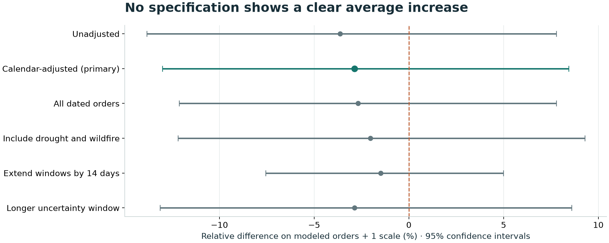

# Do disasters bring a surge in food-bank orders?

**Georgia food-distribution study · Python + SQL · Applied research**

Disaster planning often assumes orders will rise during an emergency. I rebuilt a collaborative Emory/TechBridge study to test that assumption using more than 600,000 food-order lines.

**Updated analysis:** The estimated difference was **−2.9%** (95% CI: **−13.0% to +8.4%**). The range includes no change, so this dataset does not support a blanket disaster-week surge multiplier.



**55,201 qualifying orders · 520 observed weeks · 6 model specifications**

The original Emory R analysis reported an association between disaster severity and transaction volume (p = .006). This Python + SQL analysis uses a different disaster definition, so the results are not a like-for-like replication. It describes recorded order activity, not unmet need or completed deliveries.

## See the finished work

- [Findings and decision](reports/FINDINGS.md): concise, readable directly on GitHub.
- [Standalone interactive report](reports/report.html): download and open in a browser; all charts and dependencies are embedded. GitHub's file view displays HTML source rather than running it.
- [Weekly activity figure](reports/figures/weekly_orders.png).
- [Methods and specification](docs/ANALYSIS_PLAN.md), [data dictionary](data/README.md), and [audit evidence](data/public/audit.json).
- [Interview walkthrough and recruiting materials](docs/RECRUITING.md).
- [Verification record](docs/VERIFICATION.md) and [completed release checklist](RELEASE_CHECKLIST.md).

## Why this question matters

An operations analyst needs to distinguish changing order activity from increased need or completed delivery. A regional disaster calendar is tempting as a surge-planning input, but the measurement and comparison must be credible before setting an operational rule.

This project revisits an earlier R analysis using a reproducible Python workflow and explicit SQL metrics. The most important work happens before regression:

| Audit finding | Change to the analysis |
|---|---|
| 67,260 lines had acceptance dates but zero accepted quantity | Require at least one positive-quantity line for the primary order count |
| All 606,316 line receipt dates were empty | Measure recorded order activity; do not claim deliveries or needs met |
| 31 orders had acceptance dates before creation dates | Exclude date-anomalous orders from the primary count; 29 otherwise qualified |
| One study week had no dated records | Preserve an unknown week instead of filling zero; keep real weekly distances in the covariance calculation |
| Regional event costs and item price semantics were insufficient for local value estimates | Use event-window overlap and counts; make no dollar, meal, or weight impact claim |

Source scope: 84,399 headers, 606,316 lines, 1,429 organization records. All lines link to a unique header, and line keys are unique. The source spans 2004–2024 acceptance dates; the model uses complete weeks in 2014–2023.

## Method

1. Stream selected source fields into SQLite; exclude user/contact tables.
2. Validate keys, joins, date consistency, and quantity eligibility.
3. Aggregate each order once using [order SQL](sql/orders.sql) and [weekly SQL](sql/weekly.sql).
4. Combine overlapping acute disasters into one binary weekly indicator. Drought and wildfire are a sensitivity, not primary exposure.
5. Model log(1 + orders) with year, month, and federal-holiday weekday controls.
6. Use calendar-aware Bartlett HAC uncertainty and publish all six comparison specifications.

The missing-week covariance implementation is tested against statsmodels on complete calendars and an explicit gap example. These are retrospective associations, not causal estimates, forecasts, or measured operational improvements.

## Reproduce in a fresh environment

Tested with Python 3.12. Dependencies are pinned in `requirements.txt`.

```bash
python3 -m venv .venv
source .venv/bin/activate
python -m pip install -r requirements.txt
python -m pytest
python scripts/reproduce.py
```

On Windows, use `.venv\Scripts\activate` in place of the activation command above. The code itself uses platform-independent paths.

The default workflow uses the bundled **real, aggregate data**, not simulated observations. It regenerates the models, findings, static figures, and self-contained report without the original workbook, an API key, R, or a network connection after dependency installation. `reports/analysis_weeks.csv` is regenerated and need not be committed.

To independently rebuild the aggregate data from the original source workbook, use the optional ingestion workflow in [data documentation](data/README.md). The large raw workbook and its personal/contact fields are intentionally not in the release. Without that workbook, the original-record audit cannot be independently rerun; its selected-field manifest and source hash are included.

## Repository structure

```text
data/public/          aggregate weekly data, event snapshot, audit and provenance
src/foodbank/         streaming ingestion, validation, modeling, presentation
sql/                  explicit order and weekly aggregation logic
tests/                metric, join, exposure, and uncertainty checks
scripts/reproduce.py  one-command report regeneration
reports/              finished report, figures, findings, numerical results
docs/                 methods, recruiting narrative, sources, verification
```

## Decision and limits

Use validated order counts and active organizations to describe activity. Before adopting a surge rule, obtain verified local exposure, inventory, and completed-delivery records, define the decision horizon and error costs, and evaluate the rule prospectively.

The historical project describes this as a Georgia study extract; retained structured fields do not independently verify county coverage or statewide representativeness. Order activity mixes demand, available supply, and platform participation. Regional event windows and actual local disruption may differ. Calendar controls and robust uncertainty do not resolve those issues.

## Contribution and sources

Original R analysis: **Yushu Fan**, within a collaborative AI.Data Lab / TechBridge project. The Python + SQL rebuild, tests, statistical review, and presentation were developed with **OpenAI Codex assistance**. Other original team deliverables are not claimed as solely authored. The owner confirmed permission to publish the food-bank materials; no partner endorsement is implied.

See [sources and reuse notes](docs/SOURCES.md). Actual deployment, user adoption, or an improvement in food distribution has not been measured or claimed.
